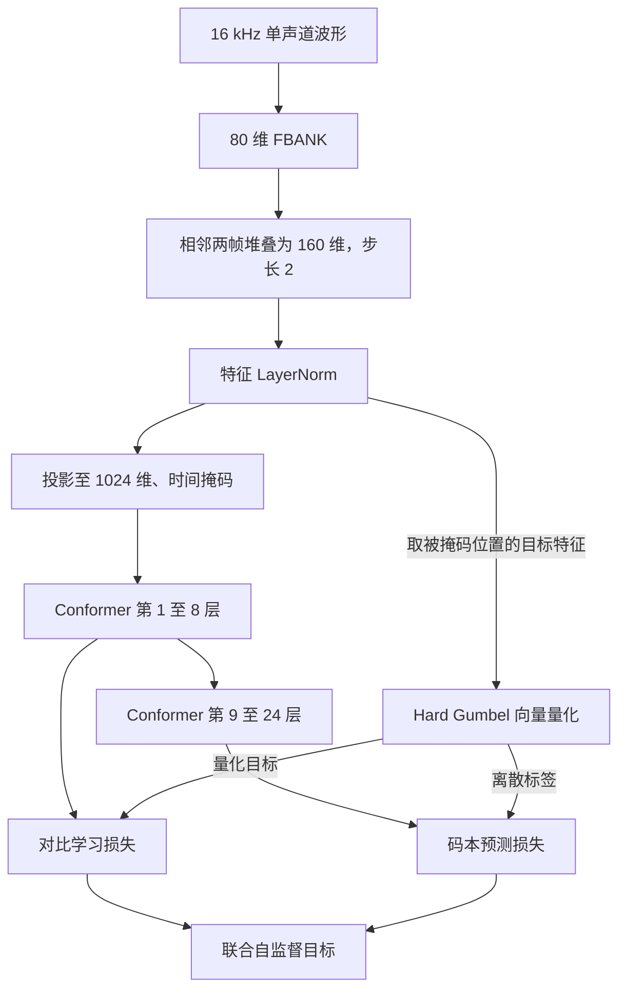

<div align="center">

# FunASR wav2vec-BERT Adapter

**在 FunASR 中搭建可阅读、可修改的语音自监督预训练流程**

从无标注音频出发，串起 FBANK、Conformer、向量量化、对比学习与掩码预测。

[](LICENSE) [](https://github.com/modelscope/FunASR) [](#模型结构) [](#数据准备)

[项目介绍](#项目介绍) · [快速开始](#快速开始) · [数据准备](#数据准备) · [模型结构](#模型结构) · [训练指南](#训练指南) · [验证与测试](#验证与测试)

</div>

---

## 项目介绍

语音自监督学习希望解决一个直接的问题：能否先让模型从大量无标注音频中学习语音表示，再将这些表示用于后续任务？wav2vec 2.0 通过对比学习区分真实目标与负例，w2v-BERT 则进一步引入对离散语音单元的掩码预测。

本项目将这条预训练流程接入 **FunASR**：模型与数据组件通过注册表加载，训练复用 FunASR 的配置、分布式启动和检查点机制；特征处理、掩码、量化器、编码器及损失计算保留在仓库中，方便逐层阅读和实验。

默认模型参考 [fairseq2 固定版本的 w2v-BERT 600m 配置](FAIRSEQ2_ALIGNMENT.md)，采用 **80 维 FBANK + 24 层 Conformer**，约 **6.09 亿参数**。这里的对齐范围是模型结构和关键算法，优化器、数据配方与完整训练过程仍由本项目配置决定。

### 本项目包含什么

| 模块 | 内容 |
| --- | --- |
| 模型 | FunASR 接口的 `Wav2Vec2Model`、`W2VBertModel` |
| 特征 | Kaldi native FBANK、相邻帧堆叠、归一化与投影 |
| 编码器 | 支持中间隐状态提取的 `Fairseq2ConformerEncoder` |
| 自监督目标 | 时间掩码、Hard Gumbel 向量量化、对比损失、码本预测 |
| 数据 | tar shard 流式读取、重采样、单声道转换、动态组 batch、rank/worker 分片 |
| 训练 | 单卡与 DDP 路径、梯度累积、按 masked target 数归一化、检查点续训 |
| 验证 | 小模型冒烟测试、数据与训练回归、可选的 fairseq2 数值对照 |

如果你希望阅读语音预训练的实现、修改量化与掩码策略，或将自己的音频数据接入 FunASR，这个仓库可以作为实验起点。当前提供预训练代码；训练数据、预训练权重和下游 ASR 微调配方需要另行准备。

> [!IMPORTANT]
> 两份 YAML 都采用相同的约 609M 模型结构。`w2vbert_pretrain_small.yaml` 只调整部分训练设置。第一次检查环境时，请先运行下面的小模型冒烟测试；完整模型的训练资源需求应按实际音频长度、batch 和优化器评估。

## 快速开始

### 第 0 步：安装环境

以下命令在仓库根目录执行。Python 3.10 可用于现有回归环境；PyTorch 与 torchaudio 请安装相互匹配、适合本机 CUDA 环境的版本。

```bash
git clone https://github.com/wwhNLP/funasr-wav2vec-bert-adapter.git
cd funasr-wav2vec-bert-adapter

# 可选：创建独立环境
conda create -n funasr-w2vbert python=3.10 -y
conda activate funasr-w2vbert

python -m pip install -r requirements.txt
export MODEL_DIR="$(pwd)"
```

依赖包括 `torch`、`torchaudio`、`funasr`、`hydra-core`、`omegaconf`、`sentencepiece`、`soundfile` 和 `kaldi-native-fbank`。模型实现无需安装 fairseq2 运行时；上游对照测试另需一份指定版本的源码。

检查 PyTorch 是否识别 GPU：

```bash
python -c "import torch, torchaudio; print('torch:', torch.__version__); print('torchaudio:', torchaudio.__version__); print('CUDA:', torch.cuda.is_available())"
```

默认使用已安装的 FunASR。若需要使用本地 FunASR 源码，可额外设置：

```bash
export FUNASR_ROOT=/absolute/path/to/FunASR
```

### 第 1 步：运行小模型冒烟测试

先用 CPU 验证模型前向、反向、量化器梯度与验证分支，无需准备音频数据：

```bash
python scripts/smoke_forward.py --device cpu
```

有可用 GPU 时，也可以测试 CUDA 和 BF16：

```bash
CUDA_VISIBLE_DEVICES=0 python scripts/smoke_forward.py --device cuda --bf16
```

输出中应包含有限的 `loss`、`valid_loss`，以及：

```text
weight: 2
quantizer_entry_proj_grad: True
```

这里使用脚本内置的小模型和合成 FBANK 输入。`weight: 2` 是样本数；训练器使用 `stats.num_targets` 统计的 masked target 数对损失和梯度归一化。

### 第 2 步：准备自己的音频

将训练集、验证集分别打包为 tar shard，再各自创建一个清单文件。完整示例见[数据准备](#数据准备)。

```text
data/
├── shards/
│   ├── train_000000.tar
│   └── valid_000000.tar
├── train_shards.list
└── valid_shards.list
```

### 第 3 步：开始预训练

清单准备好后，设置路径并启动单卡训练：

```bash
export MODEL_DIR="$(pwd)"
export TRAIN_LIST="${MODEL_DIR}/data/train_shards.list"
export VALID_LIST="${MODEL_DIR}/data/valid_shards.list"
export OUTPUT_DIR="${MODEL_DIR}/exp/w2vbert_pretrain"
export CUDA_VISIBLE_DEVICES=0

bash "${MODEL_DIR}/scripts/train_pretrain.sh"
```

日志写入 `${OUTPUT_DIR}/train.log`。默认配置训练约 609M 的完整模型；多卡、混合精度和参数覆盖方式见[训练指南](#训练指南)。

## 数据准备

### Ⅰ 无标注音频与 tar shard

默认使用 `SelfSupervisedLargeAudioDataset`。每个 tar 中的音频成员都是独立样本，无需转写文本；附带的 `.txt` 和其他非音频文件会被跳过。

```text
train_000000.tar
├── speaker_a/utt_000001.wav
├── speaker_a/utt_000002.wav
└── speaker_b/utt_000003.flac
```

读取器识别的扩展名包括 `wav`、`flac`、`mp3`、`m4a`、`ogg`、`opus` 和 `wma`。实际能否解码取决于本机音频后端；读取优先使用 `torchaudio.load`，解码器不可用时尝试 SoundFile 回退。

下面以两个已有音频目录为例，创建一份最小训练/验证数据：

```bash
mkdir -p data/shards

# 将路径替换为你已划分好的训练集、验证集目录
tar -cf data/shards/train_000000.tar -C /absolute/path/to/train_audio .
tar -cf data/shards/valid_000000.tar -C /absolute/path/to/valid_audio .

printf '%s\n' "$(pwd)/data/shards/train_000000.tar" > data/train_shards.list
printf '%s\n' "$(pwd)/data/shards/valid_000000.tar" > data/valid_shards.list
```

大规模训练时，可将每个集合拆成多个 shard，并把所有 shard 路径逐行加入相应清单。使用绝对路径，便于从不同目录启动。

```text
/absolute/path/to/train_000000.tar
/absolute/path/to/train_000001.tar
/absolute/path/to/train_000002.tar
```

### Ⅱ 读取、特征和长度单位

默认数据流程如下：

```text
shard 清单 → rank/worker 分片 → 流式读取音频成员 → 有界打乱缓冲
         → 解码、重采样、转单声道 → 长度过滤 → 排序与动态组 batch
         → collator 提取 FBANK → 模型堆叠相邻帧
```

音频在长度过滤前统一重采样到 **16 kHz**，多声道取平均值。流式路径逐个读取音频成员，不缓存整个 tar；打乱、排序与 DataLoader 预取仍会占用内存。

| 参数或张量 | 单位与默认行为 |
| --- | --- |
| `min_wav_len: 48000` | 重采样后的音频采样点数，对应 3 秒 |
| `max_wav_len: 960000` | 重采样后的音频采样点数，对应 60 秒 |
| `batch_size: 1000000` | `batch_type: frame` 时的原始波形 padding 预算 |
| `speech`（collate 前） | 单条波形 `[samples]` |
| `speech`（collate 后） | FBANK 张量 `[batch, frames, 80]` |
| `speech_lengths`（collate 后） | 每条音频的有效 FBANK 帧数 |

`batch_type: frame` 按下面的预算组 batch：

```text
batch 内最长波形的采样点数 × batch 内样本数 ≤ batch_size
```

例如，两条均为 30 秒的 16 kHz 音频占用 `480000 × 2 = 960000` 的预算。默认最大音频长度小于 batch 预算；自行修改时，也应为最长单条音频留出空间。

默认 FBANK 使用 `waveform_scale: 1.0`、`standardize: false`。YAML 中的 `frontend` 和 `tokenizer` 保持 `null`：FBANK 由 collator 提取，帧堆叠由模型完成。

### Ⅲ 多卡分片与 epoch

- shard 先按 rank、再按 worker 划分，同一遍读取中的分区互不重叠。训练集和验证集都需要为每个 rank 提供至少一个含有效音频的 shard。
- `batch_num_epoch` 是**每个 rank 每个 epoch 的精确 batch 数**，默认 `10000`。数据流不足会循环补足，超过预算则截断。
- `valid_batch_num_epoch` 独立控制验证 batch 数，两份配置均为 `100`；省略时回退到训练预算。验证也按预算执行，可能重复数据或只覆盖部分数据。

建议先检查每个分区能否产生有效 batch，再扩大训练规模。音频解码失败或被长度过滤后，某个 rank 可能没有可用数据，此时加载器会明确报错。

<details>
<summary>可选：JSONL 数据与增强视图</summary>

仓库还保留了 `SelfSupervisedAudioDataset`、`SelfSupervisedAudioDatasetWithAugmentation` 等 JSONL/map-style 组件，供自定义数据配方使用。训练数据分片配置会传递给索引，验证索引使用完整验证文件列表；默认训练教程使用 tar 路径。

如使用 `SelfSupervisedLargeAudioDatasetWithAugmentation` 且 `feature_type: fbank`，增强先作用于波形，collator 再分别提取 FBANK 并 padding：

| 输入视图 | 对应有效帧数 |
| --- | --- |
| `speech` | `speech_lengths` |
| `speech_aug1` | `speech_lengths_aug1` |
| `speech_aug2` | `speech_lengths_aug2` |

组 batch 的预算仍按原始波形采样点计算。仓库自带的预训练模型使用主视图 `speech`；若希望额外视图参与损失，需要在自定义训练目标中读取它们。

</details>

## 模型结构

### Ⅰ 从音频到两个自监督目标



对比学习分支读取第 8 层隐状态，在被掩码的位置识别对应量化目标。码本预测分支读取最后一层输出，预测离散语音单元的类别。默认联合目标包含：

```text
L = L_contrastive + 0.1 × L_diversity + 10 × L_feature_penalty + L_MLM
```

模型返回求和后的损失。`PretrainingTrainer` 累积各 microbatch 的梯度，并在优化器更新前按 masked target 总数归一化；DDP 路径同时聚合各 rank 的目标数，随后执行梯度裁剪。验证损失采用相同的目标数加权方式。

### Ⅱ 默认配置

| 配置项 | 默认值 |
| --- | --- |
| 模型 | `W2VBertModel` |
| 参数量 | `609,433,408`，约 609M |
| 编码器 | 24 层 Conformer，隐藏维度 1024 |
| 注意力 / FFN | 16 个头 / 中间维度 4096 |
| 卷积核 | 31 |
| 对比投影维度 / 负例数 | 768 / 100 |
| 时间掩码 | span 长度 10，概率参数 0.65，至少 2 个 span |
| 量化器 | 1 个码本，每个码本 1024 个条目 |
| Gumbel 温度 | `max(0.1, 2.0 × 0.999995 ** num_updates)` |

`num_updates` 按训练前向次数增长，梯度累积时与优化器更新次数不同。Conformer 相对注意力、padding、负采样与损失公式的对齐细节，以及上游接口修正，见 [FAIRSEQ2_ALIGNMENT.md](FAIRSEQ2_ALIGNMENT.md)。

### Ⅲ 两份配置的区别

| 配置项 | `w2vbert_pretrain.yaml` | `w2vbert_pretrain_small.yaml` |
| --- | --- | --- |
| 模型结构 | 24 层、1024 维 | 相同 |
| `train_conf.accum_grad` | 4 | 1 |
| `scheduler_conf.total_steps` | 1200000 | 400000 |
| `train_conf.best_model_criterion` | 验证 loss 最小 | 训练 loss 最小 |
| `train_conf.avg_keep_nbest_models_type` | `loss` | `loss` |

表中记录两份文件的实际设置。需要降低模型规模时，应修改 `model_conf`，同时保持前端、编码器和量化器维度兼容；小规模接口验证可以直接使用冒烟脚本。

## 训练指南

### Ⅰ 单卡与多卡

启动脚本根据 `CUDA_VISIBLE_DEVICES` 中的设备数量设置进程数，使用 `torch.distributed.run` 启动：

```bash
# 单卡
CUDA_VISIBLE_DEVICES=0 bash "${MODEL_DIR}/scripts/train_pretrain.sh"

# 单机双卡：先确保训练集和验证集分别有足够的有效 shard
CUDA_VISIBLE_DEVICES=0,1 bash "${MODEL_DIR}/scripts/train_pretrain.sh"
```

脚本调用 `scripts/train.py`，先注册自定义组件，再进入 FunASR 训练入口并启用 `PretrainingTrainer`。使用该入口时保留 YAML 中的 `model: W2VBertModel`，这样可以同时正确加载模型和目标数归一化逻辑。

当前训练器支持原生 PyTorch/DDP 路径；DeepSpeed 和 FSDP 的分片梯度归一化尚未接入，启用时会报错。仓库中的 `deepspeed_conf/` 是保留配置，启动脚本传入配置路径不会自动开启 DeepSpeed。多 rank 归一化逻辑已实现，多 GPU 实机联调范围见[验证与测试](#验证与测试)。

### Ⅱ 覆盖配置参数

用环境变量选择输出目录或配置文件，用 Hydra 的 `++` 参数覆盖具体设置：

```bash
export OUTPUT_DIR="${MODEL_DIR}/exp/w2vbert_run_01"
export CONFIG_PATH="${MODEL_DIR}/configs/w2vbert_pretrain.yaml"

bash "${MODEL_DIR}/scripts/train_pretrain.sh" \
  ++train_conf.max_epoch=3 \
  ++dataset_conf.batch_size=1000000 \
  ++dataset_conf.batch_num_epoch=20000 \
  ++dataset_conf.valid_batch_num_epoch=100 \
  ++train_conf.accum_grad=8 \
  ++optim_conf.lr=4e-5
```

在支持 BF16 的 GPU 上，可额外传入 `++train_conf.use_bf16=true`。调小 batch 时优先调整原始采样点预算；如仍需降低显存占用，再根据实验目标修改模型结构或音频长度上限。

| 参数 | 作用 |
| --- | --- |
| `OUTPUT_DIR` | 日志、配置与检查点输出位置 |
| `CONFIG_PATH` | 选择 YAML 配置，默认主配置 |
| `PYTHON` | 指定启动训练所用的 Python 可执行文件 |
| `dataset_conf.batch_size` | 每个 rank 的动态 batch 预算 |
| `dataset_conf.batch_num_epoch` | 每个 rank 的 epoch batch 数 |
| `train_conf.accum_grad` | 每次优化器更新累积的 microbatch 数 |
| `dataset_conf.num_workers` | 每个 rank 的数据加载 worker 数 |
| `dataset_conf.shuffler_size` / `sort_size` | 打乱 / 长度排序缓冲大小 |
| `scheduler_conf.warmup_steps` / `total_steps` | 学习率调度的优化器更新步数 |

`batch_num_epoch`、恢复位置和 `train_conf.save_checkpoint_interval` 都应落在梯度累积边界上，即能被 `accum_grad` 整除。主配置每个 epoch 为 `10000` 个 batch、累积 `4` 次，正常完成一个 epoch 对应 `2500` 次优化器更新。调整 epoch 数和累积次数时，也需要检查学习率调度预算是否符合实验计划。

### Ⅲ 检查点与断点续训

两份配置均设置了 `train_conf.resume: true`。使用相同的 `OUTPUT_DIR` 重新启动时，FunASR 会尝试从 `model.pt` 恢复模型、优化器、调度器和训练位置：

```bash
bash "${MODEL_DIR}/scripts/train_pretrain.sh"
```

训练器保存 epoch 内的绝对 batch 偏移，支持同一个 epoch 中多次中断后继续跳过已消费的数据。恢复通过重新遍历并跳过 batch 实现，因此大偏移恢复可能需要等待数据读取。

要恢复相同的数据顺序，请保持 **rank 数、worker 数、shard 清单、随机种子与组 batch 配置**一致。现有检查点恢复不保证模型随机状态逐位一致。切换模型结构时请使用新的输出目录；早期 CNN/SDConformer 配置的检查点与当前默认架构不兼容。

### Ⅳ 输出与观察

常见输出如下，具体检查点命名和保留方式受 FunASR 版本与训练设置影响：

```text
exp/w2vbert_pretrain/
├── train.log
├── config.yaml
├── model.pt
├── model.pt.best
├── model.pt.ep*
├── hydra_log/
└── tensorboard/
```

日志中的 `loss_per_target` 是按 masked target 归一化后的联合自监督损失。可以结合 TensorBoard 中的对比损失、码本预测损失、diversity 与特征惩罚项观察训练；下游识别能力仍需另外微调和评测。

## 验证与测试

### Ⅰ 本地回归

```bash
# CPU 回归
CUDA_VISIBLE_DEVICES='' python -m unittest discover -s tests -v

# 使用一张可用 GPU，包含需要 CUDA 的 launcher 测试
CUDA_VISIBLE_DEVICES=0 python -m unittest discover -s tests -v
```

测试覆盖 FP32/BF16 前向与反向、量化器梯度、掩码与 padding、远程注册、tar 流式读取、重采样、rank/worker 分片、JSONL 验证索引、增强视图、调度器、损失归一化和多次断点恢复。

CPU 环境会跳过需要 CUDA 的 launcher 测试；未设置 `FAIRSEQ2_REFERENCE` 时，会跳过依赖上游源码的对照测试。GPU launcher 测试使用小模型检查训练与检查点恢复流程。

### Ⅱ 上游数值对照与完整模型冒烟

`FAIRSEQ2_ALIGNMENT.md` 给出了固定 fairseq2 commit、参考代码加载方式、数值误差范围与验证边界。按其中说明准备源码后，可运行：

```bash
FAIRSEQ2_REFERENCE=/absolute/path/to/fairseq2-reference \
  python -m unittest discover -s tests -v
```

资源充足时，可以单独检查完整默认模型的 BF16 前向、反向和验证：

```bash
CUDA_VISIBLE_DEVICES=0 python scripts/smoke_forward.py \
  --device cuda --bf16 --config configs/w2vbert_pretrain.yaml
```

现有验证以合成输入、接口回归和上游数值对照为主。完整模型冒烟不包含完整优化器更新，不能据此推算真实长音频训练显存；真实数据长期收敛、ASR 指标和多 GPU DDP 实机联调仍需进一步验证。

## 代码导读

```text
.
├── register.py                     # 文件式注册入口
├── training.py                     # 目标数归一化与断点偏移处理
├── schedulers.py                   # WarmupPolynomialDecayLR
├── configs/
│   ├── w2vbert_pretrain.yaml        # 默认预训练配置
│   └── w2vbert_pretrain_small.yaml  # 相同模型、不同训练设置
├── datasets/
│   ├── large_audio_datasets.py      # tar 读取、重采样、动态 batch、增强
│   ├── dataloader_entry.py          # epoch 预算与恢复跳过
│   ├── fbank.py                     # Kaldi native FBANK 转换
│   ├── index_ds.py                  # JSONL 索引
│   └── self_supervised.py           # map-style 自监督数据集
├── encoder/
│   ├── fairseq2_conformer.py        # 默认相对注意力 Conformer
│   └── SDConformerEncoder.py        # 保留的早期编码器
├── models/
│   ├── wav2vec2/                   # 前端、掩码、量化器、对比目标
│   └── w2vbert/                    # 码本预测与联合损失
├── scripts/
│   ├── smoke_forward.py            # 小模型 / 完整模型冒烟
│   ├── train.py                    # 注册组件并接入自定义 Trainer
│   └── train_pretrain.sh           # 训练启动脚本
└── tests/                          # 算法、数据和训练回归
```

建议从 [`scripts/smoke_forward.py`](scripts/smoke_forward.py) 跑通最小模型，再沿着 [`W2VBertModel`](models/w2vbert/model.py) → [`Wav2Vec2Model`](models/wav2vec2/model.py) 阅读特征、编码器与两个损失分支，最后查看 [`training.py`](training.py) 和数据加载流程。

## 常见问题

**为什么启动后提示没有可用音频 batch？**

检查清单路径、每个 rank 分到的 shard、解码错误日志以及重采样后的音频时长。默认只保留 3–60 秒的音频，验证集也必须满足相同条件。

**为什么降低 `batch_size` 后内存仍然较高？**

GPU 显存还受模型、优化器与音频长度影响；CPU 内存则包括解码后的排序缓冲、打乱缓冲与 worker 预取。可分别检查 `sort_size`、`shuffler_size`、`num_workers` 和 `prefetch_factor`，按实际瓶颈调整。

**可以直接用检查点进行语音识别吗？**

预训练得到的是语音表示模型。用于 ASR 时，还需要兼容的下游结构、监督微调和评测；仓库目前未提供识别解码入口、下游微调配方或通用权重转换脚本。

**去哪里查看实现差异和历史排查？**

当前默认架构与上游数值对照以 [FAIRSEQ2_ALIGNMENT.md](FAIRSEQ2_ALIGNMENT.md) 为准。[REVIEW.md](REVIEW.md) 记录早期 CNN/SDConformer 路径的集成排查，可作为历史背景阅读。

## 致谢与开源协议

感谢以下项目提供的框架、实现与文档参考：

- [FunASR](https://github.com/modelscope/FunASR)：组件注册、训练与配置框架。
- [fairseq2](https://github.com/facebookresearch/fairseq2/tree/7f06d6f4f5d497eec02b1a238d2071eb5dc48df3)：wav2vec2 / w2v-BERT 组件与算法参考。
- [kaldi-native-fbank](https://github.com/csukuangfj/kaldi-native-fbank)：FBANK 特征提取后端。
- [MiniMind](https://github.com/wwhNLP/minimind)：本 README 的章节组织与分步实践方式参考。

本仓库原创代码采用 [MIT License](LICENSE)。派生或引用的第三方代码请同时遵守其原有许可并保留版权声明，详见 [THIRD_PARTY_NOTICES.md](THIRD_PARTY_NOTICES.md) 与 [fairseq2 许可文本](LICENSES/fairseq2.txt)。

欢迎通过 [Issues](https://github.com/wwhNLP/funasr-wav2vec-bert-adapter/issues) 交流复现结果与问题，或提交 PR 改进实现和文档。
